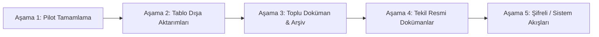

# Merkezi Dosya Üretim ve Dağıtım Altyapısı — Mevcut Sistem Envanteri (FILE-0)

- **Şartname Referansı:** [CENTRALIZED_FILE_PIPELINE_SPEC.md](../specs/CENTRALIZED_FILE_PIPELINE_SPEC.md)
- **İlk Üretici / Facade:** [FILE_GENERATION_FACADE.md](./FILE_GENERATION_FACADE.md)
- **Takip Edilen Görev:** Issue #411 ([Files FILE-0] Inventory of file generation and download points)
- **Backlog Durumu:** [TODO_CENTRALIZED_FILE_PIPELINE.md](../TODO_CENTRALIZED_FILE_PIPELINE.md) § FILE-0
- **Tarih:** 20.11.2026
- **Hazırlayan:** agent:gemini

---

## 1. Yönetici Özeti ve Amaç

Verein ERP bünyesinde modüller arası bağımsızlık, mevzuat uyumluluğu (GoBD, AO § 147, DS-GVO, JuSchG/BDSG) ve veri güvenliği temel tasarım ilkeleridir. Ancak mevcut sistemde PDF, XLSX, CSV, XML, ZIP, ICS, JSON ve Markdown formatındaki dosyaların büyük bir kısmı ilgili iş modüllerinin kendi API handler'ları içinde senkron olarak üretilmekte ve doğrudan HTTP indirme (`Content-Disposition`) yanıtı olarak istemciye sunulmaktadır.

Bu envanter çalışması (**FILE-0**), `CENTRALIZED_FILE_PIPELINE_SPEC.md` şartnamesine uygun olarak:
1. Tüm modüllerdeki dosya üretim, dışa aktarım ve indirme noktalarını eksiksiz listeler,
2. Doğrudan `Content-Disposition` başlığı oluşturan veya istemci tarafında Blob indirmesi tetikleyen noktaları belgeler,
3. Fiziksel dosya saklama (`UPLOAD_DIR`), yükleme, önizleme ve indirme akışlarını haritalar,
4. Prisma şema modellerini, bağımlılıkları, yetkilendirme ve audit davranışlarını inceler,
5. Merkezi Files altyapısına geçiş için modül bazlı önceliklendirilmiş bir göç (migration) sırası önerir.

> **Önemli Kural:** Bu çalışma yalnızca analiz ve tasarım doğrulama dokümantasyonudur. Kaynak kodda herhangi bir refactor veya iş mantığı değişikliği içermez.

---

## 2. Modül Bazında Sunucu Taraflı Dosya Üretim Noktaları

| Modül | Uç Nokta (Route) | Format / MIME | Üretim Motoru / Kütüphane | Senkron / Asenkron | Yetki / Güvenlik Kapsamı | Denetim Kaydı (Audit) |
|---|---|---|---|---|---|---|
| **accounting** | `GET /api/accounting/invoices/[id]/pdf` | PDF (`application/pdf`) | `@react-pdf/renderer` (`InvoiceDocument`) | Senkron | `accounting.view` | `EXPORT` (AccountingInvoice) |
| **accounting** | `GET /api/accounting/invoices/[id]/zugferd` | PDF/A-3 (`application/pdf`) | `@react-pdf/renderer` + `pdf-lib` (Factur-X XML gömülü) | Senkron | `accounting.view` | `EXPORT` (AccountingInvoice) |
| **accounting** | `GET /api/accounting/invoices/[id]/xrechnung` | XML (`application/xml`) | Dahili UBL/CII XML Generator (`xrechnung.tsx`) | Senkron | `accounting.view` | `EXPORT` (AccountingInvoice) |
| **accounting** | `GET /api/accounting/dunnings/[id]/pdf` | PDF (`application/pdf`) | `@react-pdf/renderer` (`DunningDocument`) | Senkron | `accounting.view` | `EXPORT` (AccountingDunning) |
| **accounting** | `GET /api/accounting/[id]/pdf` | PDF (`application/pdf`) | `@react-pdf/renderer` (`VoucherDocument`) | Senkron | `accounting.view` | `EXPORT` (AccountingBooking) |
| **accounting** | `GET /api/accounting/export/pdf` | PDF (`application/pdf`) | `@react-pdf/renderer` (`BookingListDocument`) | Senkron | `accounting.view` | `EXPORT` (AccountingBooking) |
| **accounting** | `GET /api/accounting/reports/annual/pdf` | PDF (`application/pdf`) | `@react-pdf/renderer` (`AnnualReportDocument`) | Senkron | `accounting.view` | `EXPORT` (AccountingBooking) |
| **accounting** | `GET /api/accounting/reports/ledger/pdf` | PDF (`application/pdf`) | `@react-pdf/renderer` (`LedgerDocument`) | Senkron | `accounting.view` | `EXPORT` (AccountingBooking) |
| **accounting** | `GET /api/accounting/extras/auditor-report` | PDF (`application/pdf`) | `@react-pdf/renderer` (`AuditorReportDocument`) | Senkron | `accounting.view` | `EXPORT` (AccountingBooking) |
| **accounting** | `GET /api/accounting/payables/[id]/einvoice-pdf` | PDF (`application/pdf`) | `@react-pdf/renderer` (`EinvoiceViewDocument`) | Senkron | `accounting.view` | Yok (Salt okunur önizleme) |
| **accounting** | `GET /api/accounting/export` | XLSX / CSV | `exceljs` / UTF-8 CSV | Senkron | `accounting.view` | `EXPORT` (AccountingBooking) |
| **accounting** | `GET /api/accounting/datev` | CSV (`text/csv; charset=windows-1252`) | Dahili DATEV format motoru | Senkron | `accounting.view` | `EXPORT` (DATEV Buchungsstapel) |
| **accounting** | `GET /api/accounting/reports/income-expense/export` | XLSX / CSV | `exceljs` / UTF-8 CSV | Senkron | `accounting.view` | `EXPORT` (AccountingBooking) |
| **accounting** | `GET /api/accounting/reports/ledger/export` | XLSX / CSV | `exceljs` / UTF-8 CSV | Senkron | `accounting.view` | `EXPORT` (AccountingBooking) |
| **accounting** | `GET /api/accounting/gobd/export` | ZIP (`application/zip`) | Dahili CRC-32 + STORE ZIP (`zip.ts` + `gdpdu.ts`) | Senkron | `accounting.view` | `EXPORT` (gdpdu-z3) |
| **accounting** | `GET /api/accounting/gobd/procedure` | Markdown (`text/markdown`) | Dahili şablon doldurucu (GoBD Verfahrensdok.) | Senkron | `accounting.view` | Yok |
| **accounting** | `POST /api/accounting/payment-run` | XML (`application/xml`) | `generateSepaXml` (pain.001.001.03) | Senkron | `accounting.create` | `EXPORT` (PaymentRun) |
| **donations** | `GET /api/donations/confirmations/[id]/pdf` | PDF (`application/pdf`) | Önceden üretilmiş disk dosyası + SHA-256 denetimi | Senkron (Stream) | `donations.view` | `PDF_DOWNLOAD` / `PDF_INTEGRITY_ERROR` |
| **donations** | `GET /api/donations/confirmations/batch-pdf` | PDF (`application/pdf`) | `@react-pdf/renderer` (`ConfirmationDocument`) | Senkron | `donations.view` | `EXPORT` (ZuwendungConfirmation batch) |
| **donations** | `GET /api/donations/template-preview/pdf` | PDF (`application/pdf`) | `@react-pdf/renderer` (`ConfirmationDocument`) | Senkron | `donations.view` | Yok (Örnek önizleme) |
| **donations** | `GET /api/donations/export` | XLSX / CSV | `exceljs` / UTF-8 CSV | Senkron | `donations.view` | `EXPORT` (Donations) |
| **donations** | `GET /api/donations/confirmations/export` | XLSX / CSV | `exceljs` / UTF-8 CSV | Senkron | `donations.view` | `EXPORT` (ZuwendungConfirmations) |
| **members** | `GET /api/members/[id]/receipt-pdf` | PDF (`application/pdf`) | `@react-pdf/renderer` (`ReceiptDocument`) | Senkron | `members.payments.view` | `EXPORT` (MemberReceipt) |
| **members** | `GET /api/members/export` | XLSX / CSV | `exceljs` / UTF-8 CSV | Senkron | `members.view` | `EXPORT` (Members) |
| **members** | `GET /api/members/dues/export` | XLSX / CSV | `exceljs` / UTF-8 CSV (Klasik) + `FileGeneration` (D06 Pilot) | Senkron + Asenkron | `members.view` | `EXPORT` (MemberDues) |
| **members** | `GET /api/members/[id]/data-export` | JSON (`application/json`) | Dahili DS-GVO Art. 15 JSON dökümü | Senkron | `members.update` | `DATA_EXPORT` (Member) |
| **members** | `GET /api/members/import-template` | XLSX | `exceljs` şablon oluşturucu | Senkron | `members.create` | Yok |
| **documents** | `GET /api/documents/export` | XLSX | `exceljs` | Senkron | `documents.view` | `EXPORT` (Documents) |
| **events** | `GET /api/events/export` | XLSX | `exceljs` (`event-export-service.ts`) | Senkron | `events.view` | Yok |
| **inventory** | `GET /api/inventory/export` | CSV (`text/csv`) | Dahili CSV oluşturucu (`inventory-service.ts`) | Senkron | `inventory.view` | Yok |
| **meetings** | `GET /api/meetings/[id]/minutes-pdf` | PDF (`application/pdf`) | `@react-pdf/renderer` (`MinutesDocument`) | Senkron | `meetings.view` | Yok (Toplantı gizliliği kuralı) |
| **courses** | `GET /api/courses/payouts/pdf` | PDF (`application/pdf`) | `@react-pdf/renderer` (`PayoutDocument`) | Senkron | `courses.view` (Öğretmen kısıtlı) | `EXPORT` (CoursePayout) |
| **grants** | `GET /api/grants/[id]/report-pdf` | PDF (`application/pdf`) | `@react-pdf/renderer` (`GrantReportDocument`) | Senkron | `grants.view` | `EXPORT` (Grant) |
| **progress** | `GET /api/progress/report` | PDF (`application/pdf`) | `@react-pdf/renderer` (`ReportDocument`) | Senkron | `progress.view` | Yok |
| **online-forms** | `GET /api/online-forms/[id]/pdf` | PDF (`application/pdf`) | `@react-pdf/renderer` veya DB'deki şifreli snapshot | Senkron | `online-forms.view` | `EXPORT` (OnlineFormRequest) |
| **sepa** | `GET /api/sepa/[id]/xml` | XML (`application/xml`) | DB'de saklanan pain.008.001.02 XML metni | Senkron | `sepa.create` | `EXPORT` (SepaDebitRun) |
| **calendar** | `GET /api/calendar/feed/[token]` | ICS (`text/calendar`) | Dahili iCalendar feed oluşturucu | Senkron | Token tabanlı gizli URL | Yok |
| **ai** | `GET /api/ai/reports/[id]/pdf` | PDF (`application/pdf`) | `@react-pdf/renderer` (`MarkdownPdfDocument`) | Senkron | `ai.view` + AI Consent | `EXPORT` (AiReport) |
| **exports** | `GET /api/exports/[id]` | Orijinal format | AES-256-GCM çözülmüş stream (`GeneratedFile`) | Senkron (Stream) | Sahip denetimi (`ownerId`) | `DOWNLOAD` (GeneratedFile) |

---

## 3. Doğrudan `Content-Disposition` Başlığı Oluşturan Handler'lar

Mevcut kod tabanında iki farklı yaklaşım bulunmaktadır:
1. `@/shared/files/http.ts` içerisindeki `buildDownloadResponse` yardımcısını kullananlar (RFC 5987, `nosniff`, `private, no-store` standartlarına tam uyumlu).
2. Kendi `Headers` nesnesi üzerinden elle `Content-Disposition` üreten handler'lar.

### 3.1 `buildDownloadResponse` Kullanan Handler'lar (Standart Yaklaşım)
- `src/modules/accounting/handlers/download-file.ts` (`AccountingBookingFile` indirme)
- `src/modules/accounting/handlers/payable-files.ts` (`AccountingPayable` dosya indirme)
- `src/modules/documents/handlers/download-file.ts` (`DocumentFile` indirme)
- `src/modules/meetings/handlers/download-file.ts` (`MeetingFile` indirme)
- `src/modules/feedback/handlers/feedback-api.ts` (Ekran görüntüsü indirme)
- `src/modules/mail/services/inbox-handlers.ts` (E-posta eki indirme)
- `src/modules/organization/handlers/logo.ts` (Dernek logosu servis etme)

### 3.2 Elle `Content-Disposition` Başlığı Üreten Noktalar (Merkezileştirilecek Handler'lar)
| Dosya Yolu | Başlık Formatı | Disposition Türü |
|---|---|---|
| `src/modules/accounting/handlers/pdf-support.tsx` | `inline; filename="<ascii>"; filename*=UTF-8''<encoded>` | `inline` |
| `src/modules/accounting/handlers/annual-report-pdf.tsx` | `inline; filename="<ascii>"; filename*=UTF-8''<encoded>` | `inline` |
| `src/modules/accounting/handlers/ledger-pdf.tsx` | `inline; filename="<ascii>"; filename*=UTF-8''<encoded>` | `inline` |
| `src/modules/accounting/handlers/export-bookings.ts` | `attachment; filename="<name>"` | `attachment` |
| `src/modules/accounting/handlers/export-income-expense.ts` | `attachment; filename="<name>"` | `attachment` |
| `src/modules/accounting/handlers/export-ledger.ts` | `attachment; filename="<name>"` | `attachment` |
| `src/modules/accounting/handlers/export-datev.ts` | `attachment; filename="<name>"` | `attachment` |
| `src/modules/accounting/handlers/xrechnung.tsx` | `attachment; filename="XRechnung_<no>.xml"` | `attachment` |
| `src/modules/accounting/handlers/payment-run.ts` | `attachment; filename="<messageId>.xml"` | `attachment` |
| `src/modules/accounting/handlers/gobd-export.ts` (ZIP) | `attachment; filename="GDPdU_Z3_<year>.zip"` | `attachment` |
| `src/modules/accounting/handlers/gobd-export.ts` (MD) | `attachment; filename="Verfahrensdokumentation.md"` | `attachment` |
| `src/modules/donations/handlers/confirmation-pdf.ts` | `inline; filename="<number>.pdf"` | `inline` |
| `src/modules/donations/handlers/batch-pdf.tsx` | `inline; filename="<ascii>"` | `inline` |
| `src/modules/donations/handlers/template-preview-pdf.tsx` | `inline; filename="muster-<type>.pdf"` | `inline` |
| `src/modules/donations/handlers/export-donations.ts` | `attachment; filename="<name>"` | `attachment` |
| `src/modules/donations/handlers/export-confirmations.ts` | `attachment; filename="<name>"` | `attachment` |
| `src/modules/members/handlers/receipt-pdf.tsx` | `inline; filename="<ascii>"; filename*=UTF-8''<encoded>` | `inline` |
| `src/modules/members/handlers/export-members.ts` | `attachment; filename="<name>"` | `attachment` |
| `src/modules/members/handlers/export-dues.ts` | `attachment; filename="<name>"` | `attachment` |
| `src/modules/members/handlers/data-export.ts` | `attachment; filename="<name>"; filename*=UTF-8''<encoded>` | `attachment` |
| `src/modules/members/handlers/import-template.ts` | `attachment; filename="uye-ice-aktarma-sablonu.xlsx"` | `attachment` |
| `src/modules/documents/handlers/export-documents.ts` | `attachment; filename="<name>"` | `attachment` |
| `src/modules/events/api/export/route.ts` | `attachment; filename="<name>"` | `attachment` |
| `src/modules/inventory/api/export/route.ts` | `attachment; filename="<name>"` | `attachment` |
| `src/modules/meetings/handlers/export-minutes-pdf.tsx` | `inline; filename="<prefix>-<no>.pdf"` | `inline` |
| `src/modules/courses/services/payout-pdf-handler.tsx` | `inline; filename="<no>.pdf"` | `inline` |
| `src/modules/grants/handlers/report-pdf.tsx` | `inline; filename="verwendungsnachweis-<id>.pdf"` | `inline` |
| `src/modules/progress/services/report-handler.tsx` | `inline; filename="<name>"` | `inline` |
| `src/modules/online-forms/handlers/evidence-pdf.tsx` | `inline; filename="<documentKey>.pdf"` | `inline` |
| `src/modules/sepa/handlers/run-xml.ts` | `attachment; filename="<number>.xml"` | `attachment` |
| `src/modules/calendar/api/feed/[token]/route.ts` | `inline; filename="calendar.ics"` | `inline` |
| `src/modules/ai/handlers/report-pdf.tsx` | `inline; filename="<name>"; filename*=UTF-8''<encoded>` | `inline` |
| `src/modules/exports/services/download-handler.ts` | `attachment; filename="<ascii>"; filename*=UTF-8''<encoded>` | `attachment` |

---

## 4. İstemci Tarafı Blob ve İndirme Tetikleyicileri

İstemci (UI) tarafında kullanıcıların dosya indirmesini başlatan üç ana mekanizma bulunmaktadır:

### 4.1 `URL.createObjectURL` ve Dinamik İndirme Bağlantısı (`link.download`)
Tarayıcı belleğinde geçici Blob URL'i oluşturarak indirme yapan bileşenler:
- `src/modules/accounting/components/xrechnung-button.tsx`: XRechnung XML yanıtını `response.blob()` ile alır, geçici `<a download>` ile tetikler.
- `src/modules/accounting/components/payment-run-card.tsx`: SEPA XML çıktısını API'den `response.blob()` ile alır, `Content-Disposition` başlığından dosya adını okur ve `link.click()` ile indirir.

### 4.2 Doğrudan Bağlantı (`<a href="/api/..." download>` veya Hedefli Link)
Kullanıcıyı doğrudan GET uç noktasına yönlendiren arayüzler:
- `src/modules/accounting/views/reports-view.tsx`: Gelir-Gider ve Defter-i Kebir dışa aktarım butonları.
- `src/modules/accounting/views/booking-list-view.tsx`: Fiş listesi PDF ve Excel dışa aktarım linkleri.
- `src/modules/accounting/views/tax-view.tsx`: KDV ve vergi döküm dışa aktarımları.
- `src/modules/accounting/views/payables-view.tsx`: Gelen fatura E-Rechnung PDF önizlemesi.
- `src/modules/accounting/views/invoice-detail-view.tsx`: İhtar PDF bağlantısı.
- `src/modules/accounting/views/booking-detail-view.tsx`: Fiş makbuz PDF bağlantısı.
- `src/modules/donations/views/confirmation-list-view.tsx` & `settings-view.tsx`: Bağış makbuzu ve şablon önizleme PDF'leri.
- `src/modules/members/views/dues-report-view.tsx`: Aidat dışa aktarım linki.
- `src/modules/grants/components/grant-detail.tsx`: Hibe harcama raporu PDF linki.
- `src/modules/online-forms/components/requests-app.tsx`: İmzalı form kanıt PDF'i.
- `src/modules/courses/components/payouts-panel.tsx`: Hakediş PDF indirme linki.
- `src/modules/events/views/event-detail-view.tsx`: Etkinlik listesi indirme linki.
- `src/modules/sepa/components/sepa-app.tsx`: SEPA pain.008 XML indirme butonu.

### 4.3 Ortak `PdfSplitButton` Bileşeni (`src/shared/components/ui/pdf-split-button.tsx`)
Dil seçimi (`?lang=de` / `?lang=tr`) ile PDF açılmasını sağlayan ortak açılır buton. Kullanıldığı yerler:
- `src/modules/accounting/components/report-ledger-selector.tsx`
- `src/modules/accounting/components/pdf-button.tsx`
- `src/modules/accounting/components/annual-pdf-button.tsx`
- `src/modules/accounting/components/invoice-actions.tsx`
- `src/modules/members/components/payments-panel.tsx`
- `src/modules/meetings/components/meeting-detail-actions.tsx`

### 4.4 Asenkron Durum Takibi ve İndirme Masası
- `src/modules/exports/components/files-table.tsx`: `FileGeneration` / `GeneratedFile` tabanlı kuyruk durumlarını (`QUEUED`, `PROCESSING`, `READY`, `FAILED`) listeler ve hazır olan dosyalar için `file.url` üzerinden güvenli indirme sağlar.

---

## 5. Depolama, Yükleme, Önizleme ve İndirme Akış Haritası

```mermaid
flowchart TD
    subgraph Upload_Flow["Yükleme Akışı (Upload)"]
        A[İstemci / Tarayıcı] -->|multipart/form-data| B[parseSingleFileUpload]
        B --> C[validateUpload - Boyut & Magic Bytes]
        C -->|Geçersiz| D[Hata Yanıtı - i18n]
        C -->|Geçerli| E[makeStoredName - UUID + ext]
        E --> F[saveFile - UPLOAD_DIR Altında Güvenli Yol]
        F --> G[Prisma Kaydı - storagePath, mimeType, sha256]
    end

    subgraph Preview_Download["Önizleme ve İndirme (Download/Preview)"]
        H[İstemci İsteği] --> I[requireUser + Role & Permission Check]
        I --> J[DB Kaydı & storagePath Okuma]
        J --> K[resolveSafePath - Traversal Koruması]
        K --> L{Bütünlük / SHA-256 Denetimi?}
        L -->|Uyuşmazlık| M[PDF_INTEGRITY_ERROR + 500]
        L -->|Doğrulandı| N[openReadStream / readFile]
        N --> O[buildDownloadResponse]
        O -->|PDF, JPG, PNG & inline| P[Tarayıcı İçi Önizleme]
        O -->|Diğer formatlar| Q[Dosya İndirme - Attachment]
    end

    subgraph Encrypted_Exports["Merkezi Şifreli Dışa Aktarım (Exports/Files)"]
        R[Modül Export Talebi] --> S[FileGeneration - Outbox / Automation]
        S --> T[Worker Execution]
        T --> U[Streaming Render - CSV/XLSX/PDF]
        U --> V[AES-256-GCM Şifreleme - UPLOAD_DIR/generated/<id>.bin]
        V --> W[GeneratedFile - publicationPending=false -> true]
        W --> X[GET /api/exports/<id> - GCM Doğrulama + Çözme]
        X --> Y[Güvenli İndirme Akışı]
    end
```

### 5.1 Fiziksel Klasör Topolojisi (`UPLOAD_DIR`)
Uygulama genelinde `getEnv().UPLOAD_DIR` (varsayılan: `./storage/uploads`) kök dizini altında aşağıdaki yapı kullanılır:
- `accounting/<year>/<bookingId>/<storedName>`: Muhasebe fiş ekleri
- `accounting/payables/<year>/<storedName>`: Gelen fatura PDF/XML/görselleri
- `<year>/<documentId>/<storedName>`: Evrak yönetimi belgeleri
- `meetings/<year>/<meetingId>/<storedName>`: Toplantı karar ve tutanak ekleri
- `donations/<year>/<confirmationNumber>.pdf`: Resmi bağış makbuzları
- `organization/<storedName>`: Dernek logosu
- `feedback/<storedName>`: Kullanıcı geri bildirim ekran görüntüleri
- `mail/attachments/<storedName>`: E-posta ekleri
- `system/packages/<storedName>`: Modül genişletme paketleri (.tgz)
- `generated/<id>.bin`: Şifreli (AES-256-GCM) dışa aktarım dosyaları

---

## 6. Prisma Dosya Modelleri ve Varlık İlişkileri

| Model Adı | Tanımlandığı Şema | Temel Dosya Alanları | İlişkili İş Varlığı | Saklama Tipi / Güvenlik |
|---|---|---|---|---|
| `DocumentFile` | `documents/schema.prisma` | `storagePath`, `originalName`, `mimeType`, `sizeBytes`, `extractedText` | `Document` (`onDelete: Cascade`) | `UPLOAD_DIR` disk yolu, yumuşak silme diskte kalır |
| `AccountingBookingFile` | `accounting/schema.prisma` | `storagePath`, `originalName`, `mimeType`, `sizeBytes` | `AccountingBooking` (`onDelete: Restrict`) | `UPLOAD_DIR` disk yolu, GoBD gereği silinemez |
| `AccountingPayable` | `accounting/schema.prisma` | `storagePath`, `mimeType`, `sha256` | Bağımsız gelen fatura kaydı | `UPLOAD_DIR` disk yolu, SHA-256 indeksli |
| `ZuwendungConfirmation` | `donations/schema.prisma` | `pdfStoragePath`, `pdfSha256`, `pdfSize` | `Donor`, `Member` (FK yok, yumuşak referans) | `UPLOAD_DIR` disk yolu, değişmez (immutable) anlık görüntü |
| `MeetingFile` | `meetings/schema.prisma` | `storagePath`, `originalName`, `mimeType`, `sizeBytes` | `Meeting` (`onDelete: Cascade`) | `UPLOAD_DIR` disk yolu |
| `MailInboxAttachment` | `mail/schema.prisma` | `storagePath`, `fileName`, `mimeType`, `sizeBytes`, `contentId` | `MailInboxMessage` (`onDelete: Cascade`) | `UPLOAD_DIR` disk yolu |
| `FeedbackItem` | `feedback/schema.prisma` | `screenshotPath`, `screenshotName`, `screenshotMime` | Bağımsız hata/öneri bildirimi | `UPLOAD_DIR` disk yolu, opsiyonel ekran görüntüsü |
| `OrganizationProfile` | `organization/schema.prisma` | `logoPath`, `logoMime`, `logoOriginalName`, `logoUpdatedAt` | Singleton dernek profili | `UPLOAD_DIR` disk yolu, logo önizleme cache-bust |
| `SystemPackage` | `system/schema.prisma` | `storagePath`, `sha256`, `packageSize` | Yüklenen modül paketi | `UPLOAD_DIR` disk yolu, SHA-256 tekil |
| `OnlineFormRequest` | `online-forms/schema.prisma` | `documentEnc` (base64 şifreli blob), `evidenceEnc` | Çevrimiçi onay/imza talebi | Veritabanında AES-GCM ile şifreli (`sealSecret`), diskte dosya tutmaz |
| `GeneratedFile` | `exports/schema.prisma` | `titleEnc`, `format`, `sizeBytes`, `sha256`, `source`, `publicationPending` | `FileGeneration` (`generationId` yumuşak ref) | `UPLOAD_DIR/generated/<id>.bin` içinde AES-256-GCM şifreli |
| `FileGeneration` | `exports/schema.prisma` | `generatorKey`, `generatorVersion`, `format`, `status`, `idempotencyKey` | Merkezi Automation execution bağı | Üretim yaşam döngüsü ve idempotency durum kaydı |

---

## 7. Format ve Kütüphane Bağımlılıkları ve Lisanslar

| Kütüphane / Bağımlılık | Sürüm | Kullanım Alanı | Lisans | Güvenlik / Uyumluluk Notu |
|---|---|---|---|---|
| `@react-pdf/renderer` | `^4.9.0` | PDF doküman render motoru (React öğelerinden PDF oluşturma) | MIT | Bellek içi çizim; büyük tablolarda RAM kullanımına dikkat edilmeli |
| `pdf-lib` | `1.17.1` | PDF işleme, ZUGFeRD / Factur-X XML eki gömme ve PDF/A-3 metadata | MIT | ZUGFeRD 2.2 / Factur-X e-fatura standardı için zorunlu |
| `exceljs` | `^4.4.0` | XLSX tablo üretimi, okuma ve streaming writer | MIT | Streaming writer commit edilen satırları serbest bırakır |
| `docx` | `^9.15.0` | Word (.docx) belgeleri oluşturma (`exports` modülü) | MIT | Standart Office OpenXML uyumlu |
| `unpdf` | `^2.1.0` | PDF metin çıkarma (`extract-text.ts`) | MIT | Serverless ve worker uyumlu |
| `tesseract.js` | `7.0.0` | OCR optik karakter tanıma (`documents` modülü) | Apache-2.0 | Almanca, Türkçe ve İngilizce eğitim veri paketleri dahil |
| `mammoth` | `^1.13.0` | .docx dosyalarından metin çıkarma | BSD-2-Clause | Düz metin ve HTML dönüşümü |
| `mailparser` | `^3.14.1` | E-posta MIME ve ek ayrıştırma | MIT | Stream tabanlı güvenli ayrıştırma |
| Dahili STORE ZIP (`zip.ts`) | Yerel | GDPdU / GoBD Z3 veri paketi oluşturma | Dahili (MIT) | Bağımlılıksız CRC-32 + STORE; vergi denetim yazılımları için yeterli |

---

## 8. Yetkilendirme, Kiracı İzolasyonu ve Denetim (Audit) Davranışları

1. **Yetki Matrisi:**
   - Her modül kendi izin kümesini tanımlar ve uç noktalarda `can(user.role, permissions, action)` kontrolü yapar.
   - Hassas makbuz ve hakediş PDF'lerinde katı kısıtlamalar uygulanır (ör. `courses` modülünde öğretmen yalnızca kendi hakedişini görebilir; `members` makbuzları yalnızca `memberPayments.view` yetkililerine açıktır).
2. **Kiracı İzolasyonu (Tenant Isolation):**
   - Sistem mevcut aşamada tek dernek/organizasyon kurulumuna (`OrganizationProfile`) odaklı olmakla birlikte, merkezi `FileGeneration` ve `GeneratedFile` modelleri `organizationId` ve `ownerId` alanlarını zorunlu tutarak tam kiracı izolasyonu sağlar.
3. **Veri Minimizasyonu ve DS-GVO Uyumluluğu:**
   - `writeAudit` denetim loglarında **asla** kişisel veri (ad, soyad, IBAN, açık adres) tutulmaz; yalnızca kayıt sayısı (`count`), yıl (`year`), kimlik (`entityId`) veya biçim (`format`) loglanır.
   - Üye silindiğinde kişisel veriler anonimleştirilir, ancak GoBD ve dernekler hukuku gereğince mali kayıtlar ve üretilmiş makbuzlar korunur.
4. **Bütünlük Denetimi (Integrity Checking):**
   - `ZuwendungConfirmation` indirme işleminde diskteki dosyanın SHA-256 özeti veritabanındaki değerle karşılaştırılır. Uyuşmazlık halinde indirme engellenir ve sisteme `PDF_INTEGRITY_ERROR` uyarısı kaydedilir.

---

## 9. Dağıtım, `UPLOAD_DIR`, Volume ve Yedekleme Beklentileri

- **Volume Bağlantısı:** Docker / Coolify veya bare-metal sunucularda `UPLOAD_DIR` mutlaka kalıcı (persistent volume) olarak bağlanmalıdır.
- **Birlikte Yedekleme Kuralı:** Veritabanı (PostgreSQL) dump'ı ile `UPLOAD_DIR` fiziksel dosyaları **birlikte ve aynı zaman damgasıyla** yedeklenmelidir. Veritabanı geri yüklendiğinde dosya olmaması durumunda hash bütünlük denetimleri hata üretir.
- **Yasal Saklama Süreleri (Aufbewahrungsfristen):**
  - Muhasebe fiş ve belgeleri: 8 yıl (BEG IV güncellemesi uyarınca § 147 AO).
  - Defterler, bilançolar ve yıllık raporlar: 10 yıl (§ 147 AO).
  - Bağış makbuzları: Süresiz / inceleme tamamlanana kadar silinmez.
- **Geçici Dosya Temizliği:**
  - `exports` altındaki üretilmiş geçici dosyalar `FILES_RETENTION_DAYS` (varsayılan: 7 gün) sonunda silinir.
  - `temp-uploads.ts` geçici yükleme alanı 24 saat içinde temizlenir.

---

## 10. Prisma Şema Eşleme ve Migration Kuralları

- **Çoklu Şema Düzeneği:** Her modül kendi şemasını `src/modules/<modul>/schema.prisma` altında tutar.
- **Senkronizasyon:** `scripts/sync-schemas.ts` betiği, modül şemalarını `prisma/schema/<modul>.prisma` klasörüne bağlar ve `prisma generate` öncesinde otomatik çalışır (`predev`, `prebuild`, `pretypecheck`).
- **Modüller Arası FK Yasağı:** Modüller arasında doğrudan Prisma Foreign Key (`@relation`) kurulmaz; yumuşak referanslar (`id`, `cuid`) ve anlık veri kopyaları kullanılır.
- **Geriye Dönük Uyumluluk:** Yeni migration'lar eklemeli (additive) olmalı, önceki migration dosyalarına dokunulmamalıdır.

---

## 11. Önerilen Geçiş Sırası (FILE-5 Yol Haritası)

Mevcut modüllerin merkezi `Files` / `FileGeneration` altyapısına geçişi için risk, veri hacmi ve kullanıcı etkisi gözetilerek belirlenen sıra:

### Aşama 1: İlk Pilot Doğrulaması (Mevcut Durum)
- **Modül:** `members.dues` (Aidat borç dışa aktarımı - D06 streaming ve facade).
- **Hedef:** Worker, queue, lease recovery, AES-GCM şifreli akış ve indirme masası entegrasyonunun canlıda test edilmesi.

### Aşama 2: Yüksek Hacimli Tablo (CSV / XLSX) Dışa Aktarımları
Senkron HTTP isteklerinde timeout riskini ortadan kaldırmak için toplu liste dışa aktarımlarının asenkron kuyruğa alınması:
1. `members.export` (Üye listesi Excel/CSV)
2. `accounting.export` (Fiş listesi Excel/CSV)
3. `accounting.reports.income-expense` & `accounting.reports.ledger` (Gelir-gider ve muavin Excel dökümleri)
4. `donations.export` & `donations.confirmations.export` (Bağış ve makbuz listeleri)
5. `documents.export` (Evrak envanter Excel dökümü)
6. `events.export` & `inventory.export` (Etkinlik ve envanter dökümleri)
7. `students.datev-debitoren` (DATEV borçlu aktarımı)

### Aşama 3: Toplu Doküman ve Arşiv Üretimleri
Ağır CPU / bellek tüketen çok sayfalı veya arşiv çıktılarının worker'a devredilmesi:
1. `donations.confirmations.batch-pdf` (Toplu bağış makbuzu üretimi)
2. `accounting.gobd.export` (GDPdU / GoBD Z3 ZIP paketi üretimi)
3. `accounting.reports.annual` & `accounting.reports.ledger` (Yıllık rapor ve defter PDF dökümleri)
4. `accounting.extras.auditor-report` (Kassenprüfungsbericht denetçi raporu)

### Aşama 4: Tekil Resmi Dokümanlar ve Makbuzlar
Şablon render motorlarının `Files` generator registry'sine kaydedilmesi:
1. `accounting` fatura (`invoices`), ihtar (`dunnings`) ve mahsup fişi (`vouchers`) PDF'leri
2. `accounting` ZUGFeRD PDF/A-3 ve XRechnung XML üretimi
3. `members` aidat makbuzu (`receipt-pdf`)
4. `meetings` toplantı tutanağı (`minutes-pdf`)
5. `grants` harcama kanıt raporu (`report-pdf`)
6. `courses` öğretmen hakediş belgesi (`payout-pdf`)
7. `progress` öğrenci gelişim raporu (`progress-report`)

### Aşama 5: Sistem, Güvenlik ve Uç Nokta Entegrasyonları
1. `sepa` XML (pain.008 ve pain.001) dosyalarının merkezi pipeline'a alınması
2. `online-forms` kanıt PDF'lerinin DB şifreli saklamasından Files sağlayıcısına bağlanması
3. `calendar` iCal feed'inin (hafif salt okunur akış) mimari istisna olarak tescil edilmesi veya önbellek katmanına alınması
4. Modüllerdeki doğrudan `Content-Disposition` kullanımını engelleyen lint / mimari kuralının devreye alınması (FILE-7)
