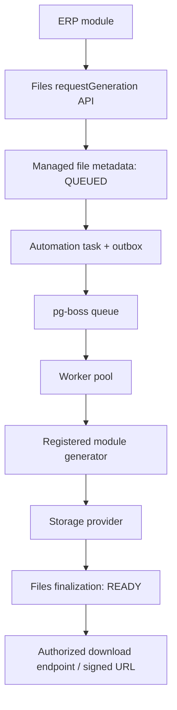

# Merkezi Dosya Üretim ve Dağıtım Altyapısı

- **Durum:** Planlandı — uygulama başlamadı
- **Proje anahtarı:** FILE
- **Bağımlılık:** Automation Core
- **Planlama kararı:** Automation P0 güvenilirlik işleri tamamlanmadan uygulamaya başlanmayacak; P1 gözlemlenebilirlik/kontrol işleriyle çakışma yaratmayacak şekilde sıralanacak.
- **Kapsam:** Tüm modüller için merkezi dosya üretim, saklama, metadata, erişim ve indirme yaşam döngüsü.

## 1. Amaç

ERP modüllerinin PDF, XLSX, DOCX, CSV, JSON, XML, Markdown, TXT, görsel, SVG ve arşiv gibi çıktıları kendi başlarına üretip doğrudan indirme yanıtı vermesini sona erdirmek. Dosya üretim talepleri ortak Files API'sinden geçmeli, üretim işleri mevcut Automation Core/pg-boss altyapısında yürütülmeli ve dosya erişimi Files modülü tarafından yönetilmelidir.

Temel sorumluluk ayrımı:

- **İş modülü:** Hangi verinin, hangi iş kuralıyla ve hangi formatta dışa aktarılacağını bilir; generator implementasyonunu sağlar.
- **Files modülü:** Dosya talebini, metadata'yı, storage anahtarını, erişim politikasını, indirme ve yaşam döngüsünü yönetir.
- **Automation modülü:** Üretim işinin kuyruğa alınması, execution, retry, idempotency, timeout, lease/recovery ve loglarını yönetir.
- **Storage provider:** Dosya byte'larını kalıcı depolar ve stream olarak sunar.

Files, Automation'ın yerine yeni bir kuyruk/worker sistemi kurmayacaktır. Automation, Files'ın yerine dosya metadata'sı veya indirme yetkisi yönetmeyecektir.

## 2. Mevcut depo durumu ve geçiş gerekçesi

Plan hazırlanırken mevcut kod tabanında aşağıdaki yapı gözlemlenmiştir:

- `src/shared/files/` içinde ortak doğrulama, yerel disk depolama, stream ve HTTP yardımcıları bulunur.
- `documents` gibi modüllerin kendi dosya modelleri ve upload akışları vardır.
- `accounting`, `members`, `donations` ve diğer modüllerde doğrudan attachment/download response oluşturan export handler'ları bulunur.
- Automation modülü kalıcı execution/outbox/pg-boss worker altyapısının sahibidir.

Bu nedenle çalışma, mevcut `shared/files` yardımcılarını bir anda silmek veya bütün modül dosya tablolarını tek tabloya zorla taşımak değildir. Önce envanter çıkarılmalı; ortak altyapı Files modülüne evriltilmeli ve modül-özel iş ilişkileri kontrollü biçimde korunmalıdır.

> Bu doküman hedef mimari ve uygulama şartnamesidir. Burada adı geçen API'ler ve modeller önerilen sözleşmelerdir; mevcut kodda zaten var oldukları anlamına gelmez.

## 3. Kapsam

### 3.1 İlk hedef formatlar

| Grup | Formatlar | Hedef aşama |
|---|---|---|
| Doküman | PDF, DOCX, ODT, TXT, MD | İlk üretici paketi |
| Tablo | XLSX, CSV | İlk üretici paketi |
| Veri | JSON, XML, YAML | İlk üretici paketi |
| Görsel | PNG, JPG/JPEG, WEBP | Sonraki üretici paketi |
| Vektör | SVG | Sonraki üretici paketi; aktif içerik güvenliği zorunlu |
| Arşiv | ZIP | Sonraki üretici paketi |
| Özel | Kayıtlı MIME/format eklentileri | İleriki genişletme |

Yükleme için kabul edilen format ile uygulamanın üretebildiği format ayrı registry/politikalar olmalıdır. Bir formatın yüklenebilmesi, o format için generator bulunduğu anlamına gelmez.

### 3.2 Kapsam dışı

İlk sürümde çevrim içi Word/PDF editörü, OCR, AI belge analizi, ortak düzenleme, harici public file hosting ve paylaşım portalı yapılmayacaktır. Bunlar ileride bağımsız yetenekler olarak değerlendirilebilir.

## 4. Hedef mimari ve akış

1. Kullanıcı bir modülde export/report/document işlemi başlatır.
2. Modül Files API üzerinden generation talebi oluşturur.
3. Files, tenant ve kullanıcı bağlamını doğrular; dosya metadata kaydını `QUEUED` olarak oluşturur.
4. Files, mevcut Automation API üzerinden tanımlı task'ı başlatır. Dosya kaydı ile execution ilişkisi tutarlı biçimde saklanır.
5. Automation outbox/pg-boss üzerinden işi worker'a teslim eder.
6. Worker, sabit kayıtlı generator key'i ile ilgili modülün server-side handler'ını çalıştırır.
7. Generator çıktıyı stream veya kontrollü geçici dosya üzerinden Storage Provider'a yazar.
8. Files finalization servisi boyut, MIME, hash ve storage metadata'sını doğrular; kaydı `READY` yapar.
9. İstemci Files API'den durumu sorgular; dosya hazır olduğunda yetkili indirme akışını kullanır.

### 4.1 Önemli transaction sınırı

Veritabanı transaction'ı ile harici pg-boss/storage işlemi tek atomik transaction gibi varsayılmamalıdır. Talep oluşturma ve Automation dispatch, mevcut Automation outbox desenini kullanmalı; arada kalan kayıtlar recovery ile onarılmalıdır. Storage'a yazma ve metadata finalization retry durumunda idempotent olmalıdır. Yarım kalmış geçici nesneler temizlenebilmelidir.

### 4.2 Akış diyagramı



## 5. Modül sözleşmesi

İş modülleri dosyayı senkron olarak üretip HTTP response'a yazmamalıdır. Modülün sorumluluğu, generator implementasyonunu ve doğrulanmış input şemasını sunmak; talebi Files API'ye vermektir.

Önerilen çağrı şekli (nihai TypeScript tipleri uygulama sırasında mevcut auth/context ve modül API desenlerine göre netleştirilecektir):

```ts
const result = await files.requestGeneration({
  moduleKey: "accounting",
  purpose: "REPORT",
  generatorKey: "accounting.annual-report",
  format: "xlsx",
  fileName: "accounting-report-2026.xlsx",
  payload: { year: 2026, detailLevel: "full" },
  idempotencyKey: "accounting:annual-report:2026",
});
```

Başarılı talep, dosyanın hazır olduğu anlamına gelmez. En az `fileId`, `status` ve `executionId` (varsa) döndürülmelidir. İstemci dosya durumunu Files API üzerinden izler.

Önerilen operasyonlar:

- `requestGeneration(...)`: Yetkili asenkron üretim talebi.
- `getFile(...)`: Tenant ve permission kontrolüyle metadata/durum.
- `getDownloadUrl(...)` veya indirme endpoint'i: Dosya hazırsa erişim kontrolü sonrası indirme erişimi.
- `cancelGeneration(...)`: İzin ve execution durumuna göre iptal.
- `retryGeneration(...)`: Yetki, hata sınıfı ve idempotency kontrolüyle yeni deneme.
- `deleteFile(...)`: Retention ve iş modülü kurallarına uygun soft-delete/silme.

Bu operasyonların tamamı public modül API'si olarak açılmak zorunda değildir; server-only service ve route/action katmanları mevcut mimariye göre ayrılmalıdır.

## 6. Generator Registry

Generator'lar uygulama kodunda statik olarak kayıt edilmelidir. Kullanıcı payload'ı, generator key'i veya veritabanındaki bir string üzerinden dinamik import/eval yapılmamalıdır.

Her generator en az şunları tanımlamalıdır:

- Benzersiz ve namespaced `key` (ör. `accounting.annual-report`).
- Sahip modül.
- Desteklenen formatlar.
- Payload Zod/schema doğrulaması.
- Generator sürümü veya uyumluluk stratejisi.
- Worker-safe handler.
- Çıktı MIME türü ve dosya adı politikası.
- İptal/AbortSignal ve stream davranışı.
- Gerekli permission/policy tanımı.

Generator worker'da Next.js request/session/UI/cache context'ine bağımlı olmamalıdır. Yetkilendirme ve kullanıcı bağlamı talep oluşturulurken doğrulanmalı; worker'a yalnızca doğrulanmış, asgari ve güvenli execution payload'ı taşınmalıdır. Hassas veri loglanmamalıdır.

## 7. Automation entegrasyon şartları

- Mevcut Automation task, execution, outbox ve pg-boss altyapısı kullanılmalıdır.
- Files kendine ait ikinci bir queue/worker/retry mekanizması oluşturmamalıdır.
- Talep oluşturma idempotency key ile korunmalıdır.
- Retry aynı mantıksal dosya talebini çoğaltmamalıdır; yeni bir bilinçli üretim talebi ayrı kimlik/versiyon oluşturabilir.
- Timeout handler'a AbortSignal iletilerek uygulanmalıdır; timeout sonrası yan etki/çalışmaya devam etme riski göz önünde bulundurulmalıdır.
- Worker lease, heartbeat, fencing token ve recovery kuralları mevcut Automation sözleşmesiyle uyumlu olmalıdır.
- Execution sonucu ile Files status güncellemesi idempotent olmalıdır.
- PENDING/queued, RUNNING/processing ve terminal durumlar arasında tutarlı geçişler tanımlanmalıdır.
- Cancellation yalnızca worker ve generator güvenli biçimde durdurulabiliyorsa başarılı sayılmalıdır.
- Dosya üretim logları fileId/executionId ile ilişkilendirilmeli; içerik veya kişisel veri loglara yazılmamalıdır.

## 8. Metadata ve veri modeli kararları

Merkezi dosya kaydı en az aşağıdaki bilgileri taşımalıdır:

- Dosya kimliği.
- Organization/tenant kimliği.
- Sahip modül ve purpose.
- Dosya durumu.
- Kullanıcıya gösterilecek orijinal ad.
- Rastgele fiziksel storage key/path.
- MIME type, uzantı, byte boyutu ve SHA-256.
- Generator key ve generator sürümü (üretilmiş dosyalar için).
- İlişkili Automation execution ID.
- Talep eden kullanıcı ve talep/tamamlanma zamanları.
- Expiration, soft-delete ve retention metadata'sı.
- Güvenli hata kodu.

Önerilen durumlar:

`QUEUED`, `PROCESSING`, `READY`, `FAILED`, `CANCELLED`, `EXPIRED`, `DELETED`.

Veri modeli tasarlanırken şu ilkeler korunmalıdır:

1. `organizationId` tenant izolasyonu için zorunludur; mevcut sistemin tenant modeliyle uyumlu olmalıdır.
2. Kullanıcı dosya adı fiziksel path/key içinde kullanılmamalıdır.
3. Fiziksel storage key tahmin edilemez olmalı ve path traversal'a kapalı olmalıdır.
4. Boyut alanı büyük dosyalar için güvenli integer tipiyle saklanmalıdır.
5. Dosya metadata'sı ile modül-özel iş ilişkisi birbirinden ayrılmalıdır.
6. Documents/Accounting gibi modüllerin mevcut file relation tabloları incelenmeden tek bir genel relation modeline zorla taşınmamalıdır.
7. Soft-delete, retention ve fiziksel silme birbirinden ayrılmalıdır.
8. Automation execution ilişkisi nullable/uyumlu tasarlanmalı; upload ile generated file aynı lifecycle'a zorlanmamalıdır.

Nihai Prisma modeli FILE-0 envanteri sonrasında hazırlanmalı; mevcut organization, permission, audit ve schema symlink/migration kuralları gözetilmelidir.

## 9. Storage Provider

Storage katmanı sağlayıcıdan bağımsız bir interface arkasında olmalıdır.

Önerilen operasyonlar:

- `put/write`: Stream veya kontrollü byte kaynağını güvenli key'e yazma.
- `getStream/read`: Dosyayı stream olarak okuma.
- `exists/head`: Nesne metadata/varlık kontrolü.
- `delete`: Nesneyi silme.
- `getSignedUrl`: Provider destekliyorsa sınırlı süreli URL üretme.

Planlanan sağlayıcı sırası:

1. Mevcut `UPLOAD_DIR` davranışını koruyan Local filesystem provider.
2. S3-compatible provider.
3. MinIO ve Cloudflare R2 gibi uyumlu servislerin konfigürasyonla desteklenmesi.

Storage key, kullanıcı girdisinden türetilmemelidir. Local provider path containment kontrolünü sürdürmelidir. Büyük dosyalar belleğe tamamen alınmamalı; stream/backpressure uygulanmalıdır. Geçici dosya ve yarım upload temizliği bulunmalıdır.

## 10. İndirme ve erişim güvenliği

- İndirme öncesinde session, tenant ve ilgili resource permission kontrolü yapılmalıdır.
- Storage bucket/directory public erişime açılmamalıdır.
- İki desteklenen model: yetkilendirilmiş uygulama download endpoint'i veya kısa süreli signed URL.
- Signed URL kısa süreli olmalı; hassas belgelerde uygulama endpoint'i tercih edilebilmelidir.
- URL üretimi dosya üretim kuyruğuna konmamalıdır; bu hızlı bir erişim/yetkilendirme işlemidir.
- İndirme yanıtları doğru Content-Type, güvenli Content-Disposition ve `Cache-Control: private, no-store` politikası kullanmalıdır.
- Dosya adları RFC 5987/UTF-8 uyumlu encode edilmelidir.
- SVG ve benzeri aktif içerikler inline sunulmadan önce sanitize edilmeli veya attachment olarak sunulmalıdır.
- Dosya içeriği ve hassas payload loglara eklenmemelidir.
- Download, preview, delete, retry ve export talebi audit edilmelidir.
- Upload ve generated output için ayrı boyut/format/quotas uygulanabilmelidir.

## 11. Files Control Center

Yetkili kullanıcılar için yönetim arayüzü:

- Dosya listesi, arama, filtre ve sayfalama.
- Status, module, format, owner, createdAt ve expiry filtreleri.
- QUEUED/PROCESSING/READY/FAILED durumları.
- Automation execution ve attempt/log detayına bağlantı.
- Başarısız işler için yetkili retry.
- Güvenli koşullarda cancel.
- Dosya indirme, soft-delete ve retention işlemleri.
- Tenant ve permission sınırlarına göre görünürlük.
- Toplam depolama, format/modül dağılımı ve üretim süresi metrikleri.

## 12. Eski modüllerden geçiş

Geçiş modül modül ve geriye uyumlu yapılmalıdır.

1. FILE-0 envanterinde bütün upload/download/export noktaları ve kütüphaneler bulunur.
2. Önce Files service ve storage altyapısı kurulur.
3. Bir örnek modülde uçtan uca pilot entegrasyon yapılır.
4. Modülün export handler'ı doğrudan dosya response'u üretmek yerine Files generation talebi verir.
5. UI, QUEUED/PROCESSING/READY/FAILED durumlarını gösterir.
6. Eski URL/route'lar kontrollü biçimde deprecate edilir; istemci ve entegrasyonlar güncellenmeden aniden kaldırılmaz.
7. Documents upload gibi mevcut dosya ilişkileri merkezi metadata'ya bağlanırken iş modülünün sahipliği ve audit davranışı korunur.
8. Bütün modüller taşındıktan sonra doğrudan download response üretimi için statik arama/lint kuralı veya mimari test eklenir.

Öncelikli adaylar: Documents, Accounting, Members, Donations; FILE-0 envanteri gerçek kapsamı belirleyecektir.

## 13. Test ve kabul kriterleri

- Generator registry key/format/module/payload doğrulama testleri.
- Files request API tenant ve permission testleri.
- Automation enqueue/outbox/idempotency/retry/recovery entegrasyon testleri.
- Aynı idempotency key ile duplicate dosya oluşmadığının doğrulanması.
- Worker crash, timeout, lease expiry ve recovery senaryoları.
- Storage provider stream, checksum, partial write cleanup ve delete testleri.
- Büyük dosya ve backpressure testleri.
- Signed URL expiry ve unauthorized download testleri.
- Cross-tenant erişimin reddedilmesi.
- SVG/aktif içerik güvenlik testleri.
- Filename/path traversal/MIME spoofing testleri.
- Migration temiz uygulanması ve schema drift olmaması.
- Mevcut export çıktılarının içerik/format regresyon testleri.
- Typecheck, lint, unit/integration test ve production build başarılı olmalı.
- Modül sınırı ve worker-safe import kontrolleri geçmeli.

## 14. Uygulama sırası ve bağımlılıklar

1. Mevcut Automation P0 güvenilirlik işleri tamamlanır.
2. Automation P1 gözlemlenebilirlik/kontrol ihtiyaçları kararlı hale getirilir.
3. FILE-0 envanter ve tasarım doğrulaması yapılır.
4. FILE-1 merkezi Files metadata/service/storage altyapısı kurulur.
5. FILE-2 Automation entegrasyonu tamamlanır.
6. FILE-3 generator registry ve format üreticileri eklenir.
7. FILE-4 download/access/lifecycle tamamlanır.
8. FILE-5 modüller kontrollü taşınır.
9. FILE-6 Control Center ve retention tamamlanır.
10. FILE-7 test, dokümantasyon ve eski yolların kaldırılması yapılır.

## 15. Açık kararlar — uygulama öncesi doğrulanacak

- Tenant/organization modelinin gerçek ilişkileri ve dosya erişim politikası.
- Mevcut upload modellerinin merkezi metadata ile nasıl ilişkilendirileceği.
- Local storage varsayılanının deployment/backup beklentileri.
- S3-compatible provider ve signed URL tercihi.
- Dosya boyutu, retention, quota ve eşzamanlı generator limitleri.
- Her format için kullanılacak kütüphaneler ve lisansları.
- Generator versioning ve tekrar üretim politikası.
- Dosya versiyonlarının aynı ManagedFile altında mı yoksa ayrı kayıtlarla mı tutulacağı.

Bu kararlar mevcut kod, deployment ve test gereksinimleri incelendikten sonra kesinleştirilmelidir. Bu şartname uygulama sırasında gerekçeli PR kararlarıyla güncellenebilir.
